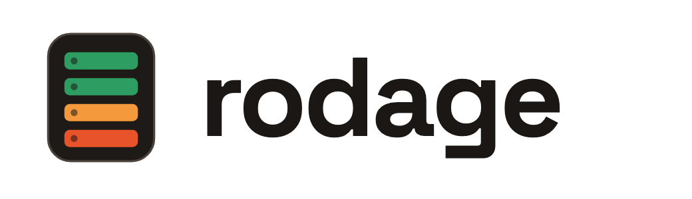

<p align="center">
  <a href="https://vjoise.github.io/rodage/">
    <picture>
      <source media="(prefers-color-scheme: dark)" srcset="brand/logo-dark.png">
      
    </picture>
  </a>
</p>

Every new GPU rack gets burned in before it goes live. The results usually end up spread across log files, spreadsheets and screenshots, and a few months later nobody can say which serial failed which test, or why a tray was swapped.

Rodage is my attempt to fix that. You describe your racks once, run your burn-in tests with one command, and see the results on a drawing of the actual rack, down to the GPU, drive or power supply that failed. Every run is kept as a record you can look back at, or hand to a customer or a vendor.

It's meant to sit on top of the tools you already use: DCGM, NCCL tests, nvme-cli and Redfish for testing, and NetBox or a spreadsheet for knowing what's where.

```console
$ rdg run rack B02 --profile gb200-burnin
  gpu-diagnostics   72/72 GPUs   pass
  nccl-allreduce    18/18 trays  warn  b02-ct5 gpu2 at 90.5%
  power-redundancy  48/48 PSUs   pass
```

## Where it stands

It's early. I have a working prototype of the rack and parts view, and test execution is what I'm building next. The code will go up here, open source, once the first version is usable. For now this repo holds the [website](https://vjoise.github.io/rodage/).

## Why "rodage"?

It's French for breaking in: running a new engine gently before you work it hard. That's what burn-in is for servers.

## Say hello

If you look after GPU hardware and this sounds familiar, I'd like to hear how you handle it today. Start a thread in [Discussions](https://github.com/vjoise/rodage/discussions).
